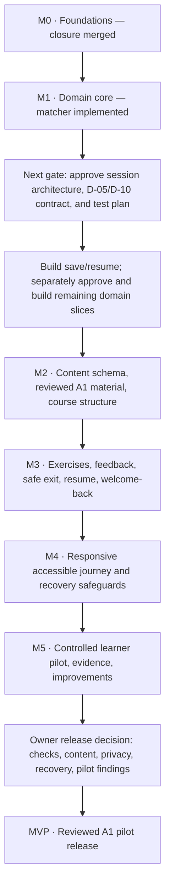
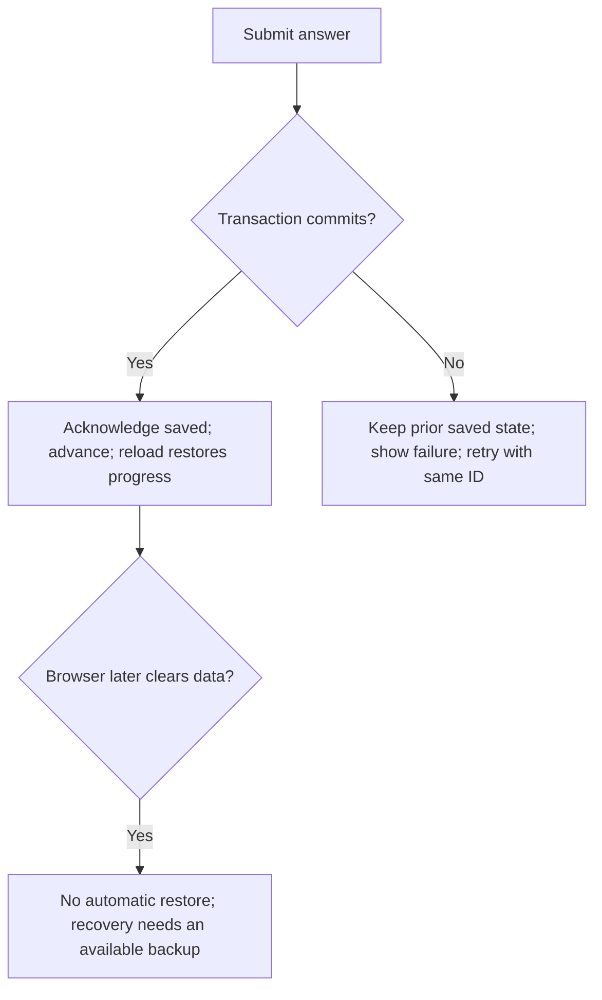
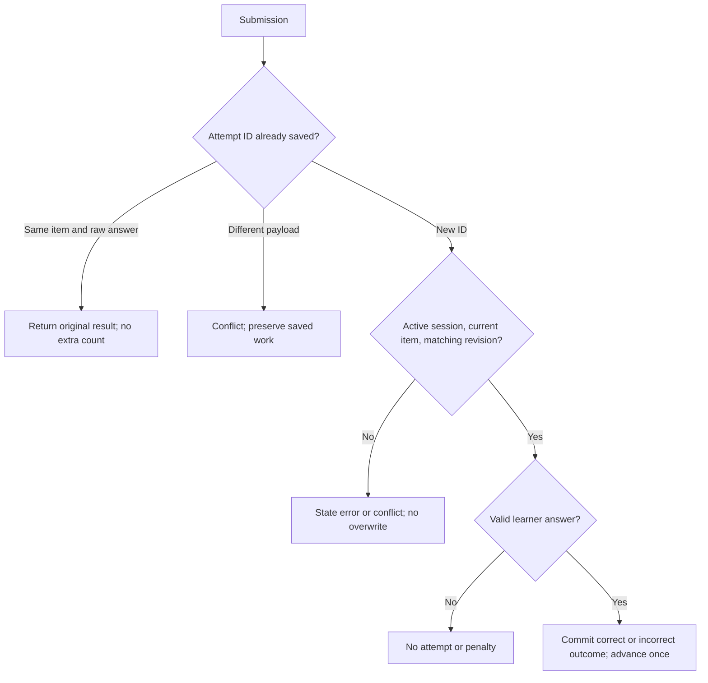
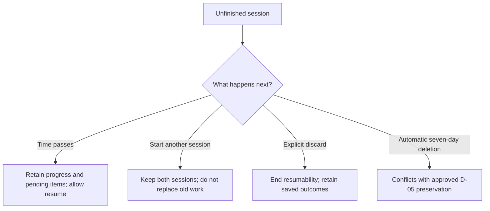

# Unpause Languages

Learn at your pace. Return whenever you're ready.

An accessible, low-pressure language-learning platform for adults. This repository
currently contains **M0 foundations and M1 matcher/session APIs**: a neutral
component harness, a German typed-answer matcher, session progress and IndexedDB
save/resume, a history-aware integrity checker, and CI configuration. These APIs
are not yet wired into a learning UI. Courses, accounts, backup/import, and adaptive
scheduling remain unimplemented. No learner pilot is permitted before the next
backup/import slice is implemented, reviewed, and passes its approved checks.

## Roadmap to the MVP

Planning snapshot: **14 November 2026**. M0 closure is merged; M1 has a tested
answer matcher. The next session save/resume slice is proposed in
[PR #11](https://github.com/Mahmoud336u/language-app/pull/11). Later milestones
remain planned. Stages are not percentages or delivery estimates.


**[Interactive roadmap and decision explorer](docs/visualizations/mvp-roadmap.html)**
— seven milestones and 17 scenarios covering saves, failures, conflicting tabs,
returning after a break, discard, and alternatives. On GitHub, open the file,
choose **Download raw file**, then open the downloaded HTML in a browser.
GitHub displays the preview above; it does not execute the explorer inside this README.
The explorer is documentation, not an implemented learning interface or a hosted deployment.

<details>
<summary>Read the roadmap and decision scenarios directly on GitHub</summary>



**1. Storage — proposed:** acknowledge an answer only after its IndexedDB
transaction commits. Browser storage is local; backup/import and device validation
remain pre-release work.



**2. Answer handling — proposed:** correct and incorrect answers each advance
once. Invalid input does not count. Session completion does not assert mastery.



**3. Unfinished work:** indefinite preservation is approved in direction;
the exact save/resume and discard behavior below is proposed in PR #11.



Each new slice follows proposal → architecture review → owner decision → approved
contract → RED → GREEN → REFACTOR → quality gates → independent PR review.
Exploring an option does not approve it. The initial course scope is an A1 pilot;
A2–B2, AI chat, payments, and social learning are outside this initial scope.

</details>

## Development

Use Node **24.22.1** and npm **11.9.0** (`nvm use` if installed):

```bash
npm ci
npx playwright install chromium
npm run dev
```

Use `npm_config_cache=/tmp/unpause-npm-cache` when the default npm cache is not writable.
For an environment-provided Chromium, set
`PLAYWRIGHT_CHROMIUM_EXECUTABLE_PATH=/absolute/path/to/chromium` explicitly. CI installs
the browser version associated with the pinned Playwright package.

## Required checks

```bash
npm run lint
npm run typecheck
npm run test:run
npm run build
npm run test:e2e
npm run test:integrity
npm run test:deployment
npm run test:mutation
```

The browser suite uses the production build, so build before running it. It also
runs the separate, non-shipping IndexedDB harness in Chromium locally and in
Chromium, Firefox, and WebKit in CI (`npm run test:storage` to run it alone). The
deployment suite builds automatically and serves assets with local Wrangler;
it does not provision or deploy anything.

`npm run test:integrity` tests the checker using temporary Git repositories.
`npm run check:test-integrity` audits this branch against `origin/main` and returns
nonzero for protected changes. It is **not** a substitute for the base-owned GitHub
check. The trusted acknowledgment mechanism covers governance findings only;
frozen-test findings cannot be cleared by an ordinary PR approval or an
`/integrity-approve` comment. See [the PR #13 correction record](docs/reviews/m1-session-test-correction.md).

## Engineering references

- [Hard rules](AGENTS.md) and [engineering policy](docs/tdd-policy.md)
- [Product decisions](docs/product-decisions.md) — D-03/D-04, D-05 v2, and scoped D-10 v1 approved; D-15 approved for course scope only
- [German answer matching](docs/answer-matching.md)
- [Session save/resume and persistence boundaries](docs/session-persistence.md)
- [Architecture](docs/architecture.md)
- [Testing and TDD evidence](docs/testing.md)
- [CI, trust bootstrap, and owner setup](docs/ci.md)
- [Design foundations](docs/design-system.md)
- [Content review](docs/content-authoring.md)
- [Deployment boundaries](docs/deployment.md)
- [M0 architecture review](docs/reviews/m0-architecture-review.md)
- [Owner authorization](docs/reviews/m0-owner-authorization.md)
- [M0 verification report](docs/reviews/m0-completion-report.md)
- [First M1 slice report](docs/reviews/m1-matcher-completion-report.md)
- [M1 session implementation and remaining merge gate](docs/reviews/m1-session-completion-report.md)

The GitHub repository remains `Mahmoud336u/language-app` by owner instruction. The
application/package is named `unpause-languages`. MIT license; see [LICENSE](LICENSE).
